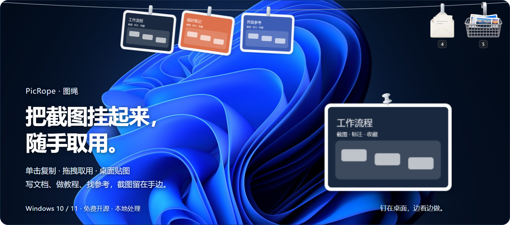
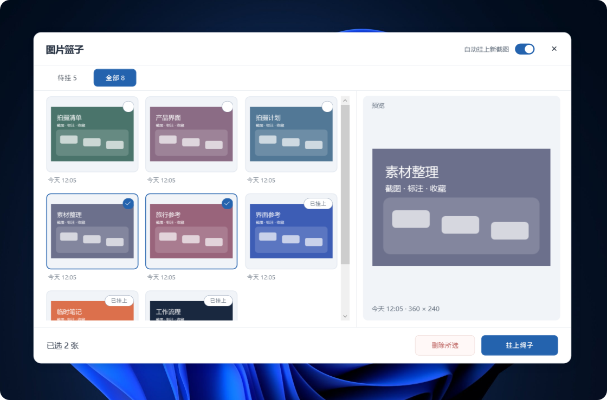
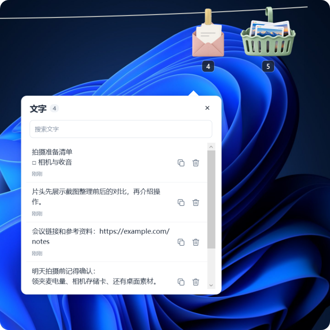
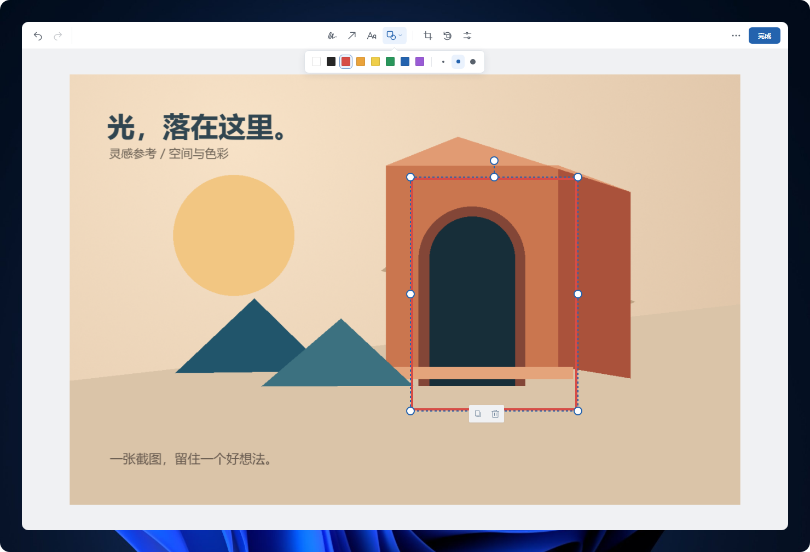
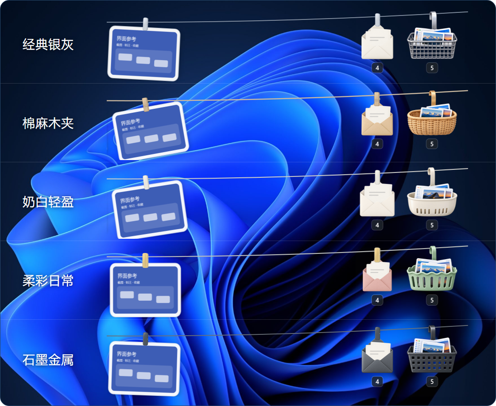

<p align="center">
  
</p>

<h1 align="center">PicRope · 图绳</h1>

<p align="center">Windows 截图暂存与桌面贴图工具</p>

<p align="center">
  <a href="https://github.com/Renly1994/PicRope/releases/latest"></a>
  
  <a href="LICENSE"></a>
</p>

<p align="center">
  <a href="https://github.com/Renly1994/PicRope/releases/latest"><strong>下载 Windows 版</strong></a>
  · <a href="#功能">功能</a>
  · <a href="#开始使用">开始使用</a>
  · <a href="#常见问题">常见问题</a>
  · <a href="https://github.com/Renly1994/PicRope/issues">反馈</a>
</p>



PicRope 将截图暂存在屏幕上沿，单击复制、拖拽取用，也可以取下图片，钉在桌面上对照。鼠标移到顶部展开，离开后自动收起，适合写文档、做教程和整理参考图。

> 此 fork 修复了 Windows 截图工具重复上绳，以及编辑保存后原图细节变模糊的问题。
> 连续两秒内像素完全相同的剪贴板图片会合并；不同内容、两秒后的相同截图和手动导入仍可正常收集。
> 编辑器按原始像素导出，保留未修改区域的清晰度；此前已经保存模糊的图片需从原图重新编辑。

## 功能

- **截图收集** — 自动收集 Windows 截图文件夹中的新图片，支持剪贴板图片与手动导入；手动添加的图片保存为副本。
- **复制与拖拽** — 单击复制图片，拖入聊天框、文档等目标应用；滚轮浏览更多挂图。
- **桌面贴图** — 将图片固定置顶，拖动调整位置，滚轮缩放，点击图钉可重新挂回。
- **图片篮子** — 保存暂时不用的截图，支持多选、大图预览与批量挂图。
- **文字信封** — 收集剪贴板文字，支持搜索、查看全文与复制，保留原文换行和缩进。
- **本地编辑** — 直接标注、添加文字、裁剪和旋转，图片处理在本机完成。
- **区域截图** — 自定义快捷键框选，原地画框、画圆、加箭头、涂画、写文字或打局部马赛克，支持撤销、重做及调整选区。
- **桌面适配** — 五套外观、多显示器选择、顶部自动收起，支持开机启动和应用内更新。

## 开始使用

1. 从 [Releases 下载最新版](https://github.com/Renly1994/PicRope/releases/latest)，完整解压后运行 `Install.cmd`。
2. 启动图绳，用 `Win+PrtScn` 截图。保存到 Windows 截图文件夹的新图片会自动挂上。
3. 将鼠标移到屏幕上沿展开绳子，单击图片复制，或拖拽到需要的应用。

**系统要求：** Windows 10 / 11 64 位、.NET Framework 4.8；内置编辑器需要 [Microsoft Edge WebView2 Runtime](https://developer.microsoft.com/microsoft-edge/webview2/)。

> 使用 `Win+Shift+S`、`PrtScn` 或微信 `Alt+A` 时，在托盘右键菜单 →「剪贴板收集」中开启「图片」。图片与文字的剪贴板收集独立控制，默认都关闭。

开启图片收集后，也可收集复制的图片内容。图文混排和资源管理器中复制的文件不会自动收集，本地图片可以通过「添加图片」手动加入。

<details>
<summary>快捷键与常用操作</summary>

| 操作 | 方式 |
| --- | --- |
| 显示 / 收起 | `Ctrl+Alt+T`，或单击托盘图标 |
| 区域截图与标注 | `Ctrl+Alt+S`，或托盘「更多操作」→「区域截图」；框选后标注，Enter 完成，Esc／右键取消 |
| 修改截图快捷键 | 托盘「更多操作」→「截图快捷键」，按新组合键后保存；冲突时保留原绑定 |
| 全选与批量删除 | 图片篮子全选当前标签；文字信封勾选或全选搜索结果，再点击「删除所选」确认数量 |
| 打开图片 | 双击图片，使用系统默认图片应用 |
| 编辑图片 | 长按图片，或图片右键 →「编辑」 |
| 桌面贴图 | 单击夹子取下；单击图钉挂回 |
| 放回篮子 | 图片右键 →「取下放篮子」 |
| 批量取下 | 图片右键 →「批量取下」，可选择左侧、右侧、其他图片或全部 |
| 保存副本 | 图片右键 →「保存副本」 |
| 选择显示屏幕 | 托盘右键 →「显示屏幕」，跟随鼠标或固定到指定屏幕 |
| 更换外观 | 托盘右键 →「外观」 |
| 开机启动 / 检查更新 | 托盘右键 →「更多操作」 |

拖拽效果由目标应用决定。拖拽移动完成后，图片自动从绳子取下。固定屏幕断开时暂用主屏，重连后恢复原来的选择。

</details>

## 界面预览

### 图片篮子

在「待挂」与「全部」之间切换，多选图片后批量挂上绳子。



### 桌面贴图与文字信封

参考图置顶对照，常用文字搜索取用。

<p align="center">
  
  
</p>

### 内置编辑器

长按图片进入编辑，支持画框、箭头、文字、裁剪与旋转。



<details>
<summary>五套外观</summary>

经典银灰、棉麻木夹、奶白轻盈、柔彩日常、石墨金属。绳子、夹子、篮子和信封同步切换。



</details>

## 常见问题

<details>
<summary>为什么截图没有自动出现？</summary>

默认监听 Windows 截图文件夹。`Win+Shift+S`、`PrtScn`、微信 `Alt+A` 等将图片放到剪贴板的截图方式，需要先在托盘右键菜单的「剪贴板收集」中开启「图片」。

如果关闭了「新图片自动上绳」，新收集的图片会进入图片篮子，选中后点击「挂上绳子」即可。重新开启只影响之后的新图片。

</details>

<details>
<summary>图片和文字保存在哪里？</summary>

设置、收集副本和文字记录保存在程序旁的 `data` 文件夹，重启后仍可取用。截图与编辑内容在本机处理，无需上传。

绳子保留最近 50 张图片的展示记录，超出的图片仍保留在篮子和本地。文字收集关闭后保留已有记录，相同内容不会重复收集。

绳子右侧的篮子和信封分别随剪贴板图片、文字收集开关显示，关闭后自动补齐空间。已有内容仍可从托盘取用。关闭剪贴板收集不影响主动区域截图和截图文件夹收集；新图片按「新图片自动上绳」开关进入绳子或篮子，取消框选不生成文件。

</details>

<details>
<summary>「取下放篮子」和删除有什么区别？</summary>

「取下放篮子」保留本地文件和收集记录，可以重新挂回。删除图绳收集的副本时，副本会移到回收站；对于截图文件夹及旧版记录中的外部图片，删除只移除图绳记录，保留原文件。编辑外部图片时会先创建副本。

托盘「更多操作」中的「全部取下」保留所有原文件。删除文字只移除选中的文字记录。

</details>

<details>
<summary>支持哪些图片格式？</summary>

支持 PNG、JPG/JPEG、BMP、GIF、TIF/TIFF。GIF、TIFF 等多帧图片只编辑第一帧；模糊与像素化作用于整张图片。

区域截图工具条中的马赛克只处理划定区域；调整截图选区时，标注保留在原屏幕位置。基础截图标注无需 WebView2。

</details>

<details>
<summary>如何更新和卸载？</summary>

1.1.0 起支持应用内更新。托盘右键 →「更多操作」→「检查更新」，下载安装后重启，保留图片、设置和开机启动。1.0.0 用户需先手动安装一次支持更新的版本。

程序启动后及运行期间也会检查本仓库 GitHub Releases 的正式版，并通过系统通知提醒。更新文件经过大小、SHA256 和程序版本校验；取消或下载失败不影响当前程序，安装替换失败会恢复旧文件。

可从 Windows「已安装的应用」中卸载，卸载会清理图绳收集的副本、设置和缓存。

</details>

## 开发

Windows 版本使用 C# 与 WPF。在 PowerShell 中执行：

```powershell
.\build.ps1
```

构建自动清理七天以前的生成测试数据。运行 `./tests/CleanArtifacts.ps1 -KeepDays 0` 可即时清理测试数据，不涉及用户截图、设置和安装备份。

生成发布包：

```powershell
.\build.ps1 -Package
```

<details>
<summary>发布与应用内更新</summary>

将生成的 `PicRope-版本号-windows-x64.zip` 上传至对应的 `v版本号` 正式 Release，并设为最新版本。发布草稿、预发布版及源码包不会触发自动升级。

</details>

## 许可与致谢

图绳是 [Tendedero](https://github.com/alejandrobujan/tendedero) 的独立 Windows 社区移植版本，使用独立名称与图标，不代表上游项目。

许可、名称与图标条款及来源声明见 [LICENSE](LICENSE) 和 [NOTICE](NOTICE)。第三方许可随安装包提供。

展示图背景采用微软发布的 [Windows 11 Bloom 壁纸](https://blogs.windows.com/windowsexperience/2021/10/06/windows-11-blossoms-with-bloom-a-new-symbol-for-a-new-operating-system/)，版权归 Microsoft 所有。
